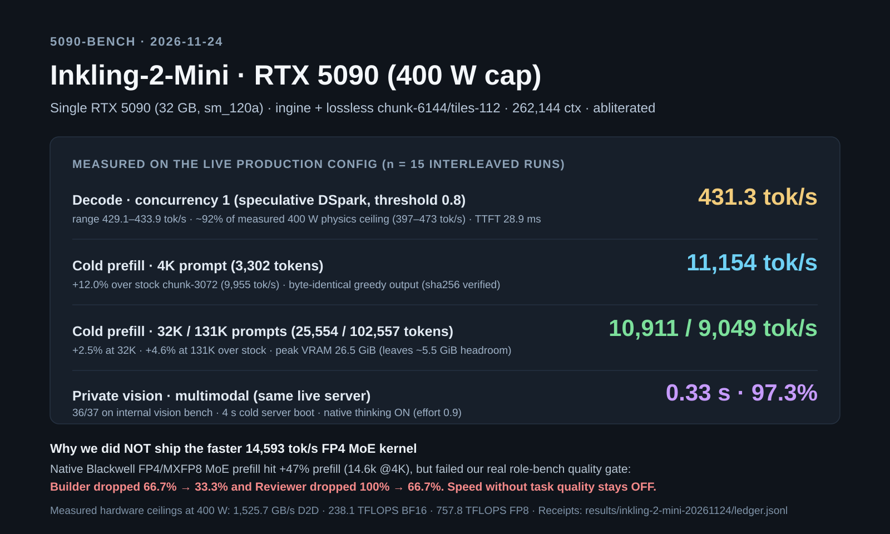
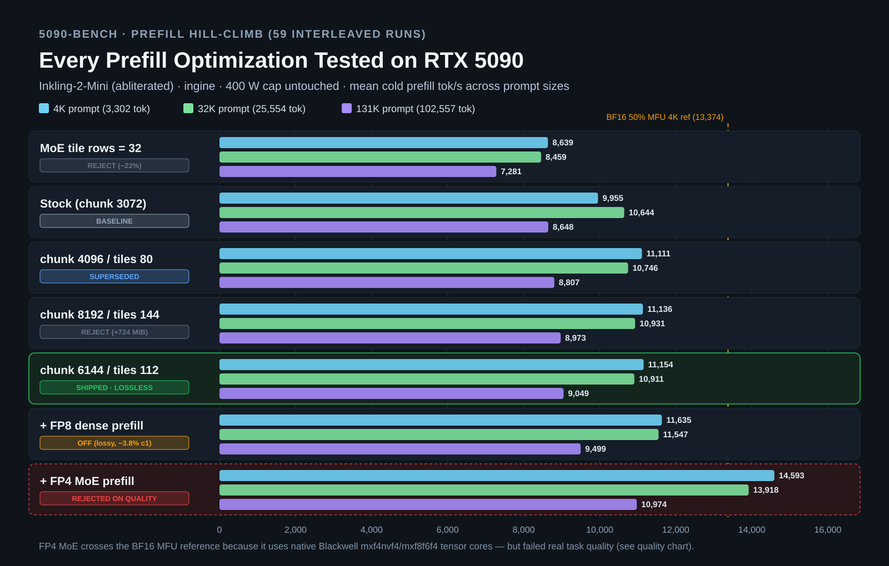
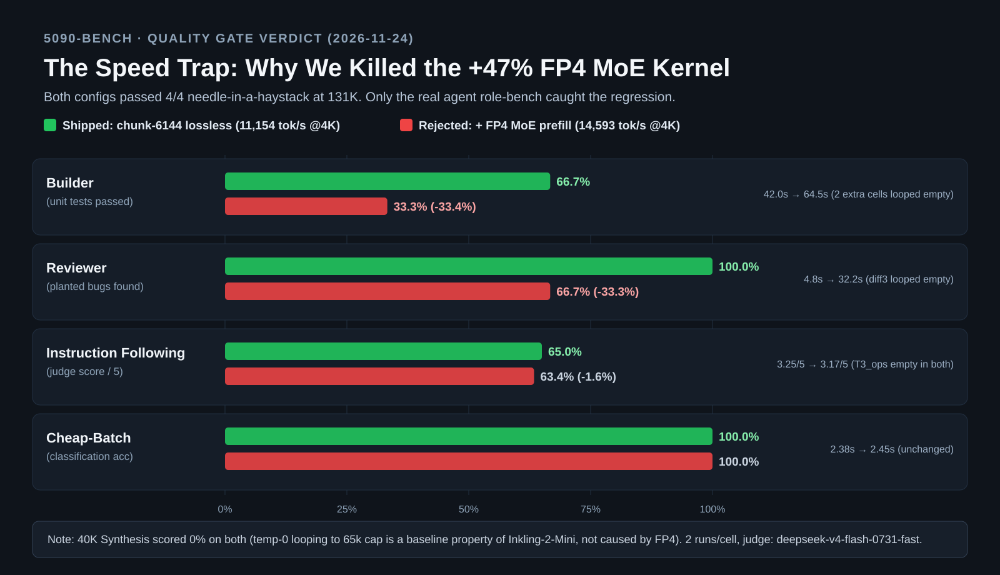
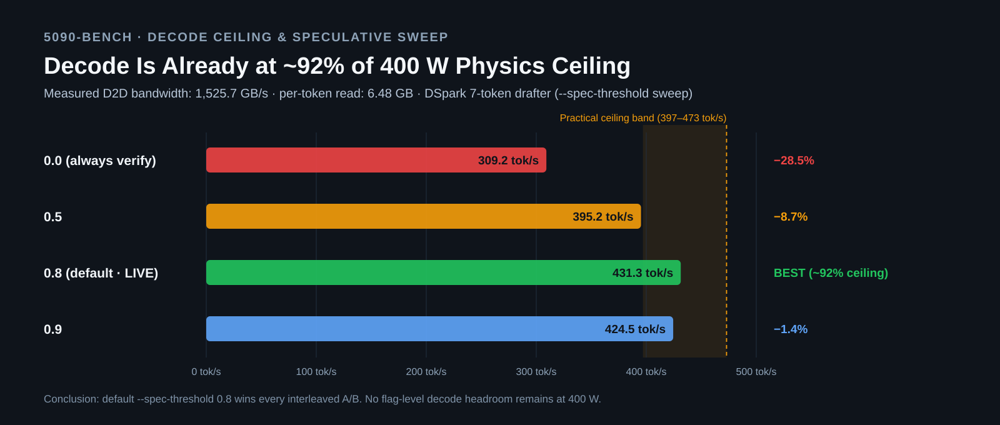

<h1 align="center">⚡ 5090-bench</h1>

  <b>Single NVIDIA RTX 5090 (32 GB, Blackwell sm_120a) · 400 W cap · speed AND real-work quality, dated.</b> 
  Recipes, configs, kernel patches, and honest benchmarks for running local models on one RTX 5090 — keeping only what survives real agentic work.

  
  
  
  
  

  

---

## 📌 Now serving: Inkling-2-Mini (abliterated) · `ingine` + lossless `chunk-6144`

Our RTX 5090 (400 W power cap untouched) serves **Inkling-2-Mini (abliterated)** on **`ingine`** with our verified lossless `prefill_chunk=6144 / kAttnMaxTiles=112` patch at **262,144-token context** (`--dense-fp8 --kv-fp8 --spec --spec-threshold 0.8`):

- **Decode (c1):** **431.3 tok/s** mean across 15 interleaved runs (range 429–434 tok/s) — **~92% of the card's measured 400 W memory-bandwidth ceiling** (1,525.7 GB/s D2D).
- **Cold prefill:** **11,154 tok/s @ 4K** (+12.0% over stock), **10,911 tok/s @ 32K** (+2.5%), **9,049 tok/s @ 131K** (+4.6%), with **byte-identical greedy output** (`sha256=fcec56817bbcbc67`).
- **Private vision:** **0.33 s**, **97.3%** (36/37 on our internal vision benchmark), 4 s cold server start, native thinking ON.
- **Why we did NOT ship our fastest kernel:** We built a native Blackwell `mxf4nvf4`/`mxf8f6f4` MoE prefill kernel that hit **14,593 tok/s @ 4K (+46.6% over stock)** and passed 4/4 needle-in-a-haystack checks at 131K — **and then killed it** because real agentic work exposed a severe quality cliff (Builder 66.7% → 33.3%, Reviewer 100% → 66.7%). Fast garbage is not a win.

Full recipe & patches: **[`models/inkling-2-mini/README.md`](models/inkling-2-mini/README.md)** · Full lab log: **[`models/inkling-2-mini/JOURNAL.md`](models/inkling-2-mini/JOURNAL.md)**

---

## 🧭 Lanes

One 32 GB Blackwell card. Every model we benchmark on it gets a lane, a dated config, and an honest verdict.

| | Lane | Status | Best verified numbers (400 W cap) | Role fit |
| :-: | --- | --- | --- | --- |
| ⚡ | **[Inkling-2-Mini (abliterated) · `ingine` + chunk-6144](models/inkling-2-mini/README.md)** | 🟢 **live** since 2026-11-24 | **431.3 tok/s c1 decode** · **11,154 / 10,911 / 9,049 tok/s** cold prefill (4K/32K/131K) · **28.9 ms TTFT** · **0.33 s vision (97.3%)** · 262K ctx · 26.5 GiB VRAM | **Private vision, Reviewer (100% @ 4.8 s), Cheap-batch (100% @ 2.4 s)**. *Not* a replacement for large MoE on long-form synthesis/builder (loops at temp 0 on 3/14 fixtures). |
| 🔬 | [Inkling-2-Mini · `ingine` + native FP4 MoE prefill](models/inkling-2-mini/README.md#what-we-tested-and-rejected-and-why) | 🔴 **rejected** (quality) | **14,593 / 13,918 / 10,974 tok/s** prefill (+47% / +31% / +27%) · **23.9 ms TTFT** · 4/4 needles @ 131K | **Failed role-bench quality gate** (Builder 33.3%, Reviewer 66.7%). Patches kept in repo as a cautionary receipt, disabled in production. |

---

## 📈 The Prefill Hill-Climb (59 interleaved runs)

Every experiment was run interleaved against its control on the same 400 W card (`scripts/bench.py`, zero failed runs) and logged to [`results/inkling-2-mini-20261124/ledger.jsonl`](results/inkling-2-mini-20261124/ledger.jsonl).

  

| Config | Status | c1 decode | 4K prefill | 32K prefill | 131K prefill | TTFT | Notes |
|---|---|---:|---:|---:|---:|---:|---|
| Stock (`chunk=3072`) | baseline (n=14) | 430.9 | 9,955 | 10,645 | 8,648 | 28.9 ms | Upstream `556acc7` |
| `chunk=4096 / tiles=80` | superseded (n=2) | 430.6 | 11,111 | 10,746 | 8,807 | 29.0 ms | Real win, beaten by 6144 |
| **`chunk=6144 / tiles=112`** | **🟢 SHIPPED (n=15)** | **431.3** | **11,154** | **10,911** | **9,049** | **28.9 ms** | **Lossless, byte-identical, +1.1 GiB VRAM** |
| `chunk=8192 / tiles=144` | rejected (n=2) | 430.6 | 11,136 | 10,931 | 8,973 | 28.8 ms | Plateaued; +724 MiB VRAM for nothing |
| `INGINE_MOE_TILE_ROWS=32` | rejected (n=2) | 432.1 | 8,639 | 8,459 | 7,281 | 28.6 ms | −20% to −23% prefill |
| `+ INGINE_PREFILL_FP8_DENSE=1` | off (n=3) | 415.7 | 11,635 | 11,547 | 9,499 | 28.1 ms | Lossy; −3.8% c1 bench decode drift |
| `+ INGINE_PREFILL_FP4_MOE=1` | 🔴 rejected (n=6) | 415.9 | 14,593 | 13,918 | 10,974 | 23.9 ms | **Failed quality gate (below)** |

---

## 🚨 The Speed Trap: Why Needles Lied and Real Work Caught It

Both the shipped lossless config and our +47% FP4 MoE kernel scored **4/4 on 32K and 131K needle-in-a-haystack** with byte-identical retrieved codes. If we had stopped at throughput + needles, we would have shipped a broken engine.

Running our full multi-role agent benchmark (2 runs per cell, temperature 0, same harness, `/proc/$PID/environ` verified) exposed the real cost of dynamic NVFP4 activation quantization on MoE prefill:

  

| Agent role | Shipped (`chunk-6144`, lossless) | Rejected (`+ FP4 MoE`) | What broke |
|---|---:|---:|---|
| **Builder** (unit tests passed) | **66.7%** (42.0 s) | **33.3%** (64.5 s) | `rate_limiter` looped to 65,536 tokens & returned empty (both runs) |
| **Reviewer** (planted bugs found) | **100.0%** (4.8 s, 0 FP) | **66.7%** (32.2 s, 0 FP) | `diff3` looped to 65,536 tokens & returned empty (both runs) |
| **Instruction Following** | **65.0%** (3.25 / 5) | **63.4%** (3.17 / 5) | `T3_ops` looped on both configs |
| **Cheap-Batch** | **100.0%** (2.38 s) | **100.0%** (2.45 s) | Unchanged |
| **Synthesis (40K bundle)** | 0.0% (empty both runs) | 0.0% (empty both runs) | Baseline Inkling-2-Mini temp-0 looping (not caused by FP4) |

---

## 🧱 Hardware Ceilings & Decode Sweep (400 W Cap)

Before touching a single kernel, we measured the 5090's actual 400 W ceilings on-device (not spec-sheet numbers):

- **Device-to-device memory bandwidth:** **1,525.7 GB/s** (40 × 512 MiB copy)
- **BF16 GEMM (4096³ cuBLASLt):** **238.1 TFLOPS**
- **FP8 E4M3×E4M3 GEMM (cuBLASLt):** **757.8 TFLOPS** (3.18× BF16)

With Inkling-2-Mini reading **6.48 GB/token** (FP8 dense + active NVFP4 experts across 48 visits) and DSpark 7-token speculative drafting, the practical c1 decode ceiling is **397–473 tok/s**. Our live **431.3 tok/s** sits at **~92% of physics**, and sweeping `--spec-threshold` confirmed default `0.8` is already optimal:

  

---

## 📂 Repo layout

- `models/<model>/README.md` — production recipe, flags, build commands, and verdict
- `models/<model>/JOURNAL.md` — dated engineering log of every experiment and dead end
- `models/<model>/configs/` — reproducible serving env + JSON profile
- `models/<model>/patches/` — exact `git format-patch` diffs (`0001` shipped; `0002`–`0003` archived rejected experiments)
- `results/<run>/ledger.jsonl` — raw interleaved benchmark measurements (all 59 runs)
- `scripts/` — `bench.py`, `ceiling.py` (from [`sybil-solutions/inference-optimisation-skill`](https://github.com/sybil-solutions/inference-optimisation-skill), MIT), and `charts/make_charts.py` (regenerates all SVGs + PNGs straight from `ledger.jsonl`)
- `docs/images/` — publication charts (SVG + 1600 px PNG)

## 🙏 Credits & Upstream

- **Hill-climb methodology & harness (`scripts/bench.py`, `scripts/ceiling.py`):** adapted from [`sybil-solutions/inference-optimisation-skill`](https://github.com/sybil-solutions/inference-optimisation-skill) (MIT) — physics-ceiling-first workflow, noise-controlled interleaved A/B benchmarking, and ledger tracking.
- **Serving engine:** [`satellitedown/inkling-2-mini-abliterated-ingine`](https://github.com/satellitedown/inkling-2-mini-abliterated-ingine) (`ingine`, Blackwell `sm_120a`).
- **Base model:** [`thinkingmachines/Inkling-2-Mini`](https://huggingface.co/thinkingmachines/Inkling-2-Mini).

