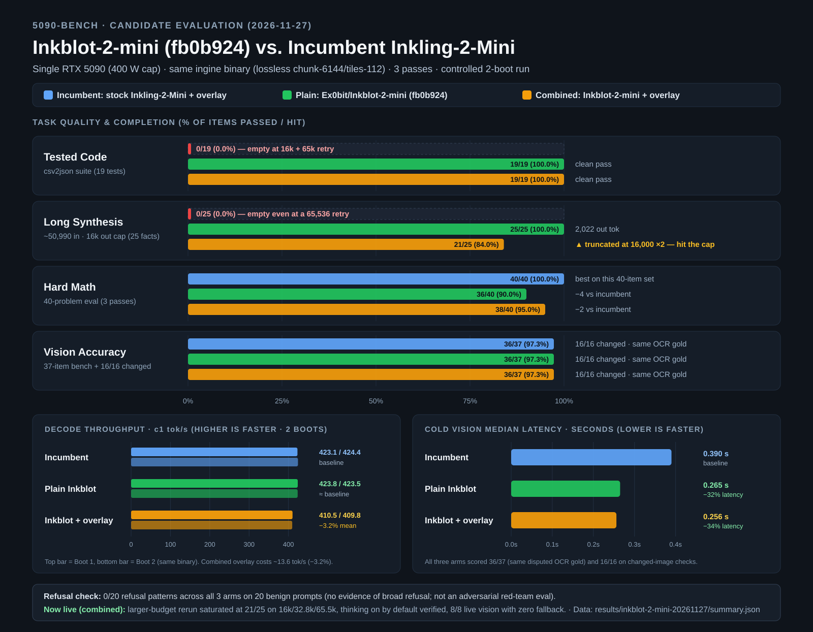

# Inkblot-2-mini (`fb0b924`) vs. Incumbent Inkling-2-Mini on RTX 5090

**Status:** ✅ **live since 2026-11-27** — promoted as the *Combined* arm (Inkblot + ablation overlay). Default thinking verified, live vision proven, real limits measured, rollback snapshot kept.  
**Candidate checkpoint:** [`Ex0bit/Inkblot-2-mini` @ `fb0b924`](https://huggingface.co/Ex0bit/Inkblot-2-mini/tree/fb0b924f46a74331e34ce4f4288177f9dc0383c8) (method & paper: [`eelbaz/Recursive-Self-Improving-Loopers`](https://github.com/eelbaz/Recursive-Self-Improving-Loopers) by Eric E., Tensorbend.ai Research)  
**Base model:** [`thinkingmachines/Inkling-2-Mini`](https://huggingface.co/thinkingmachines/Inkling-2-Mini)  
**Engine & overlay:** [`satellitedown/inkling-2-mini-abliterated-ingine` @ `556acc7`](https://github.com/satellitedown/inkling-2-mini-abliterated-ingine/tree/556acc7) + lossless patch [`0001`](../inkling-2-mini/patches/0001-prefill-accept-prefill_chunk-6144-kAttnMaxTiles-112-.patch) (`prefill_chunk=6144 / kAttnMaxTiles=112`), ablation overlay [`satellitedown/Inkling-2-Mini-abliterated-ingine`](https://huggingface.co/satellitedown/Inkling-2-Mini-abliterated-ingine)  
**Hardware:** Single NVIDIA GeForce RTX 5090 (32 GB, Blackwell `sm_120a`), **400 W power cap**

---

## Summary Chart

<p align="center">
  
</p>

Regenerate directly from [`results/inkblot-2-mini-20261127/summary.json`](../../results/inkblot-2-mini-20261127/summary.json):

```bash
python3 scripts/charts/make_inkblot_chart.py
```

---

## Experiment Design & Controls

This evaluation compares three model configurations in a **controlled same-binary, two-boot experiment** on one RTX 5090 at **400 W**:

- **Same binary:** `ingine-serve` compiled from upstream [`556acc7`](https://github.com/satellitedown/inkling-2-mini-abliterated-ingine/tree/556acc7) with our verified lossless `prefill_chunk=6144 / kAttnMaxTiles=112` patch ([`0001`](../inkling-2-mini/patches/0001-prefill-accept-prefill_chunk-6144-kAttnMaxTiles-112-.patch)). All lossy prefill experiments (`INGINE_PREFILL_FP4_MOE`, `INGINE_PREFILL_FP8_DENSE`) remain OFF.
- **Same recurrence depth:** **3 passes** across all three arms (upstream `Inkblot-2-mini` also supports 4-pass execution; 4-pass mode was not tested in this run).
- **Three arms:**
  1. **Incumbent (`stock Inkling + overlay`):** [`thinkingmachines/Inkling-2-Mini`](https://huggingface.co/thinkingmachines/Inkling-2-Mini) + [`satellitedown`](https://huggingface.co/satellitedown/Inkling-2-Mini-abliterated-ingine) ablation overlay (`--ablation`).
  2. **Plain (`Ex0bit/Inkblot-2-mini` @ `fb0b924`):** [`Ex0bit/Inkblot-2-mini`](https://huggingface.co/Ex0bit/Inkblot-2-mini/tree/fb0b924f46a74331e34ce4f4288177f9dc0383c8) without the ablation overlay.
  3. **Combined (`Inkblot + overlay`):** `Ex0bit/Inkblot-2-mini` (`fb0b924`) + the same `satellitedown` ablation overlay.

---

## Results (Public-Safe Aggregates)

| Dimension | Scope | Incumbent (`Inkling + overlay`) | Plain (`Inkblot fb0b924`) | Combined (`Inkblot + overlay`) | Notes |
|---|---|---:|---:|---:|---|
| **Tested code** | `csv2json` unit-test suite (19 tests) | 0/19 (empty) | **19/19** | **19/19** | Incumbent returned empty at 16k budget and again on 65k retry |
| **Long synthesis** | ~50,990 input tok · 16k output budget (25-fact proxy) | 0/25 (empty) | **25/25** (2,022 out tok) | 21/25 (trunc @ 16k ×2) | Incumbent empty even on retry; Combined hit the 16,000-token output cap twice |
| **Hard math** | 40-problem math eval (3 passes) | **40/40** (100.0%) | 36/40 (90.0%) | 38/40 (95.0%) | Incumbent led this 40-item set |
| **Vision accuracy** | 37-item vision suite | 36/37 (97.3%) | 36/37 (97.3%) | 36/37 (97.3%) | All three missed the same disputed OCR gold item |
| **Vision changed images** | 16 changed-image checks | 16/16 | 16/16 | 16/16 | Identical across all three arms |
| **Vision cold median** | Cold request median latency | 0.390 s | 0.265 s (−32%) | **0.256 s** (−34%) | Lower latency on both Inkblot arms in this run |
| **Decode c1 (Boot 1)** | Same-binary throughput | 423.1 tok/s | **423.8 tok/s** | 410.5 tok/s | Plain matches incumbent; Combined −3.0% |
| **Decode c1 (Boot 2)** | Second-boot replication | **424.4 tok/s** | 423.5 tok/s | 409.8 tok/s | Replicated cleanly across boots; Combined −3.4% |
| **Benign refusal check** | 20 benign prompts | 0/20 refusals | 0/20 refusals | 0/20 refusals | Zero refusal patterns on benign prompts across all three arms |

---

## Takeaways & Fair Scope Caveats

1. **Looping / empty-output failures disappeared on Plain Inkblot for tested code and ~51K synthesis.**
   - Under this 16k output budget, the incumbent returned empty on both `csv2json` (even after a 65k retry) and the ~50,990-token synthesis task (even on retry).
   - **Plain `Inkblot-2-mini`** passed **19/19** on `csv2json` and hit **25/25** on the synthesis fact proxy while finishing concisely in **2,022 output tokens**, at essentially identical decode throughput (`423.8 / 423.5` vs `423.1 / 424.4 tok/s`).
2. **Stacking the ablation overlay on Inkblot (`Combined`) showed measurable friction.**
   - `Combined` also passed **19/19** on `csv2json` and recovered half of the math gap (`38/40` vs `36/40`), but **truncated at 16,000 output tokens twice** on synthesis (`21/25`) and lost **~13.6 tok/s (−3.2%)** decode throughput across both boots (`410.5 / 409.8` vs `423.1 / 424.4`).
3. **Hard math still favored the incumbent on this 3-pass 40-item set.**
   - Incumbent scored **40/40**, ahead of Combined (**38/40**) and Plain (**36/40**).
4. **Vision accuracy was unchanged; cold median latency improved on both Inkblot arms.**
   - Upstream `Inkblot-2-mini` leaves vision weights untouched; all three arms scored **36/37** (same disputed OCR gold item) and **16/16** on changed-image checks. Cold vision medians were **0.265 s** (Plain) and **0.256 s** (Combined) vs **0.390 s** (Incumbent).
5. **Scope boundaries (read fairly):**
   - **Tested code** covers a single unit-tested fixture (`csv2json`, 19 tests), not a multi-repo coding suite.
   - **Synthesis** measures a 25-fact proxy on one ~50,990-token bundle at a 16k output cap, not full human prose evaluation across multiple bundles.
   - **Hard math** reflects one 40-problem eval at 3 passes.
   - **Benign refusal check** (`0/20` refusal patterns on all three arms) shows **no evidence of broad refusal behavior on benign prompts**; it is **not** an adversarial red-team test and does not measure parity with abliteration on adversarial prompts.
   - **Three passes only:** all arms ran at the default 3-pass depth; 4-pass execution was not evaluated here.

---

## Pending Separately (Do Not Treat as Final Cutover)

**Done — this is now the live configuration.** The three follow-ups ran:

- **Larger-budget rerun** (same ~50,990-token prompt at 16k / 32.8k / 65.5k output) — fact recall **saturated at 21/25 on all three budgets**, outputs strict prefixes of each other, and the useful summary ends after ~1,955 chars; the rest is a ticket-number repetition loop. Extra budget costs latency (31 s → 50 s → 101 s) and buys no recall, so the per-request synthesis budget stays 16,000.
- **Default thinking verified** — the live endpoint emits reasoning **with no `reasoning_effort` field sent**, and an explicit `effort=none` still reasons (template default is always-on). Multi-turn replay of `reasoning_content` verified over three turns.
- **Cutover** — weights directory + overlay swapped in the serving config; same binary, same flags, same 400 W cap, same served model id (no client change), rollback snapshot verified restorable.

Post-cutover live checks: 8/8 vision cases correct on `ripper-5090` with **0 fallback calls**, a real worker smoke task that wrote a correct parser, 5/5 benign prompts answered with zero refusal patterns.

### Token limits (measured, not assumed)

Context is **one shared pool**: input + thinking + answer.

| Quantity | Value |
|---|---|
| Engine context | 262,144 |
| Generation reserve (speculative verify) | 8 tokens |
| Max input at minimum output | **262,135** (262,136 → 500 at the engine) |
| Max output at the 51k synthesis prompt | 211,146 |
| Oversized `max_tokens` | clamped to remaining room, never rejected |
| CLI default `max_tokens` | 65,536 |

`max_tokens` is a **ceiling**, not a cap: the CLI sends the ceiling and the engine clamps to the room actually left. No artificial per-request limit was added for normal chat or worker use. The 16,000 figure below is a *benchmark* budget.
